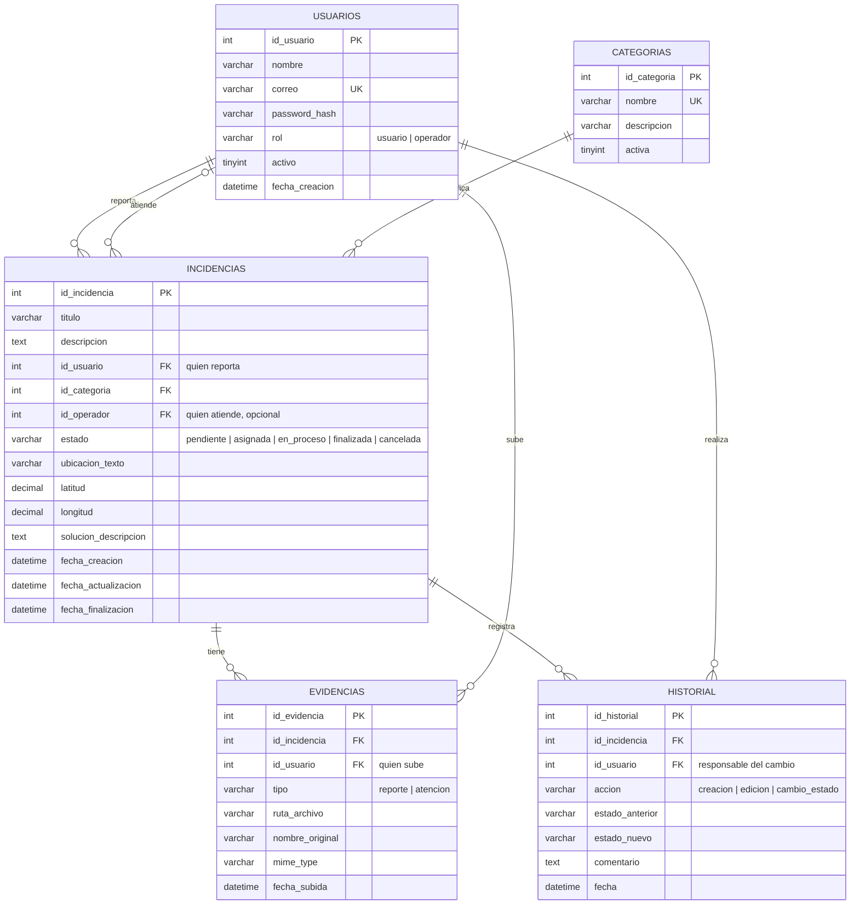

# Modelo de datos: Sistema de mantenimiento universitario

Motor de base de datos: MySQL 8.0.16 o superior. El script de creación está en `database/schema.sql`.

## Diagrama entidad-relación



## Relaciones

| Relación | Cardinalidad | Descripción |
|---|---|---|
| usuarios → incidencias (reporta) | 1 a N | Un usuario puede reportar muchas incidencias; cada incidencia tiene un solo autor. |
| usuarios → incidencias (atiende) | 1 a N, opcional | Un operador atiende muchas incidencias. `id_operador` es nulo mientras está pendiente. |
| categorias → incidencias | 1 a N | Cada incidencia pertenece a una categoría. |
| incidencias → evidencias | 1 a N | Una incidencia puede tener varias fotos (del reporte y de la atención). |
| incidencias → historial | 1 a N | Cada creación, edición o cambio de estado queda como una fila de historial. |
| usuarios → evidencias / historial | 1 a N | Se guarda quién subió la evidencia y quién hizo cada cambio. |

## Diccionario de datos

### usuarios
| Columna | Tipo | Restricciones |
|---|---|---|
| id_usuario | INT | PK, AUTO_INCREMENT |
| nombre | VARCHAR(100) | NOT NULL |
| correo | VARCHAR(150) | NOT NULL, UNIQUE |
| password_hash | VARCHAR(255) | NOT NULL (hash bcrypt, nunca texto plano) |
| rol | VARCHAR(20) | NOT NULL, CHECK en (`usuario`, `operador`), default `usuario` |
| activo | TINYINT(1) | NOT NULL, default 1 |
| fecha_creacion | DATETIME | NOT NULL, default CURRENT_TIMESTAMP |

### categorias
| Columna | Tipo | Restricciones |
|---|---|---|
| id_categoria | INT | PK, AUTO_INCREMENT |
| nombre | VARCHAR(80) | NOT NULL, UNIQUE |
| descripcion | VARCHAR(255) | opcional |
| activa | TINYINT(1) | NOT NULL, default 1 |

### incidencias
| Columna | Tipo | Restricciones |
|---|---|---|
| id_incidencia | INT | PK, AUTO_INCREMENT |
| titulo | VARCHAR(150) | NOT NULL |
| descripcion | TEXT | NOT NULL |
| id_usuario | INT | NOT NULL, FK → usuarios, ON DELETE RESTRICT |
| id_categoria | INT | NOT NULL, FK → categorias, ON DELETE RESTRICT |
| id_operador | INT | FK → usuarios, ON DELETE RESTRICT; nulo mientras está pendiente o cancelada |
| estado | VARCHAR(20) | NOT NULL, CHECK en los 5 estados, default `pendiente` |
| ubicacion_texto | VARCHAR(200) | opcional (edificio, aula, etc.) |
| latitud / longitud | DECIMAL(9,6) | CHECK de rango, opcionales |
| solucion_descripcion | TEXT | obligatoria al finalizar |
| fecha_creacion | DATETIME | NOT NULL, default CURRENT_TIMESTAMP |
| fecha_actualizacion | DATETIME | NOT NULL, se actualiza sola en cada UPDATE |
| fecha_finalizacion | DATETIME | obligatoria al finalizar |

### evidencias
| Columna | Tipo | Restricciones |
|---|---|---|
| id_evidencia | INT | PK, AUTO_INCREMENT |
| id_incidencia | INT | NOT NULL, FK → incidencias, ON DELETE CASCADE |
| id_usuario | INT | NOT NULL, FK → usuarios, ON DELETE RESTRICT |
| tipo | VARCHAR(20) | NOT NULL, CHECK en (`reporte`, `atencion`) |
| ruta_archivo | VARCHAR(255) | NOT NULL |
| nombre_original | VARCHAR(255) | opcional |
| mime_type | VARCHAR(100) | opcional |
| fecha_subida | DATETIME | NOT NULL, default CURRENT_TIMESTAMP |

### historial
| Columna | Tipo | Restricciones |
|---|---|---|
| id_historial | INT | PK, AUTO_INCREMENT |
| id_incidencia | INT | NOT NULL, FK → incidencias, ON DELETE CASCADE |
| id_usuario | INT | NOT NULL, FK → usuarios, ON DELETE RESTRICT |
| accion | VARCHAR(30) | NOT NULL, CHECK en (`creacion`, `edicion`, `cambio_estado`) |
| estado_anterior / estado_nuevo | VARCHAR(20) | CHECK en los 5 estados, nulos cuando no aplica |
| comentario | TEXT | opcional |
| fecha | DATETIME | NOT NULL, default CURRENT_TIMESTAMP |

## Estados y transiciones

```
pendiente → asignada → en_proceso → finalizada
pendiente → cancelada
```

## Reglas de integridad y de negocio

1. **Regla del sistema:** una incidencia no puede estar `finalizada` sin `solucion_descripcion` (no vacía) y sin `fecha_finalizacion`. Está garantizado con un `CHECK` en la base de datos y además debe validarse en el backend para devolver un error claro.
2. Si el estado es `asignada`, `en_proceso` o `finalizada`, la incidencia debe tener `id_operador`.
3. Las transiciones válidas **las valida el backend** (Issue B7), porque un `CHECK` no puede comparar el estado anterior con el nuevo. Cada cambio se inserta en `historial`.
4. Que `id_operador` pertenezca a un usuario con rol `operador` también lo valida el backend.
5. No se pueden borrar usuarios ni categorías con incidencias asociadas (`ON DELETE RESTRICT`). Para desactivarlos se usan `activo` / `activa`.
6. Cancelar una incidencia es un cambio de estado (`cancelada`), no un borrado, y queda registrado en el historial.
7. Al borrar una incidencia se borran sus evidencias e historial (`ON DELETE CASCADE`), aunque en la práctica se prefiere cancelar.
8. Las `CHECK` solo se aplican en MySQL 8.0.16 o superior. Hay que confirmar la versión del servicio donde se desplegará la base de datos (Issue B9).
